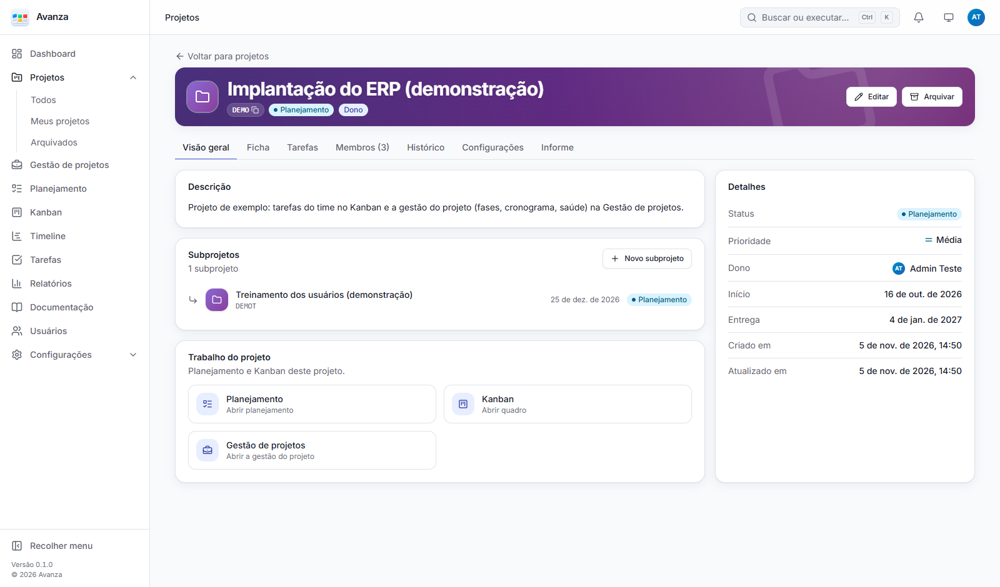

<h1 align="center">Avanza</h1>

<p align="center"><strong>Somax Agro's project management platform.</strong><br />Projects, tasks, Kanban, Monday-style management and documentation in one place.</p>

Avanza is Somax's installation of [BLYD Sync](#origin-and-license). Packages, environment variables and technical identifiers keep the `kamban` name. The name and logo shown on screen are set in **Settings → General**.

[Português](README.md) · [Changelog](CHANGELOG.md) · [Deployment](docs/deployment.md) (Portuguese)



> The screenshots show the Portuguese interface; the app is also available in Spanish and English.

## Features

- **Projects:** Overview, Charter, Tasks, Members, History, Settings and Report tabs, shown according to each person's role.
  - **Parent project and subprojects** (one level). The "Parent project" field links a project to a larger program, and the parent shows a **Subprojects** card.
  - **Charter:** objectives, features linked to tasks, scope and measured results. It can be printed in A4.
  - **PDF report** of the project.
  - **History** as a timeline.
  - **Responsible area** and **urgency** on projects, tasks and Kanban.
- **Tasks:** task types with 17 custom field types, status workflow with allowed transitions, required fields per status and WIP limits; Kanban, sprints, Timeline, comments with @mentions, attachments and notifications.
- **Project management:** numbered groups, items and subitems, custom columns, Schedule (Gantt with baseline), Kanban, project log, issues and project health.
- **Documentation:** spaces and pages with a rich editor, versions and search.
- **Access control** in one screen, with the tabs **By person**, **Roles** and **Permissions by role**.
  - Each role also defines **what it sees inside a project**: Charter, Tasks, Kanban, Project management, History, Members and Report.
  - Project roles: manager, member, viewer and **IT owner**.
  - The IT owner sees only the project brief and the tasks assigned to them or marked **Visible to IT** 💻.
- **Integrations:** REST API (`/api/v1`, OpenAPI) with personal API tokens, email, signed webhooks and realtime updates.
- Portuguese, Spanish and English; light and dark themes; mobile and desktop.

## Installation

**Docker:**

```bash
cp .env.docker.example .env      # set KAMBAN_ADMIN_EMAIL and KAMBAN_ADMIN_PASSWORD
docker compose up -d
```

**Without Docker** (Node.js 22 or newer):

```bash
cd backend && npm ci && npm run setup && cd ..
cd web && npm ci && cd ..
cp backend/.env.example backend/.env
npm --prefix backend run create-admin
npm run build
```

Then run PocketBase with the production flags in [docs/deployment.md](docs/deployment.md#produção). Finally, in **Settings → General**, set the name "Avanza", the logo and the icon.

## Upgrading

1. Read the [CHANGELOG](CHANGELOG.md).
2. **Back up** `pb_data`, from the `/_/` panel or by copying the whole folder with the service stopped.
3. Docker: `git pull && docker compose up -d --build`. Without Docker: `git pull`, `npm ci` in `backend/` and `web/`, `npm run build`, then restart the service.
4. Migrations run on startup. Check the logs and `GET /api/v1/health`.

> ⚠️ The avanza.local server has features that are not in this repository yet (Files, Homologation). Merge new code **without overwriting** them.

## Development

`npm run dev` (API :8090 + web :5173) · `npm run check` (lint, types, all tests) · `npm run e2e` · `npm run demo` · `npm run screenshots`. Stack: React 19 + TypeScript + Vite on the web, PocketBase 0.40 with JavaScript hooks (Clean Architecture) on the backend — see [docs/architecture.md](docs/architecture.md).

## Origin and license

Avanza is based on BLYD Sync, open source under the [Apache License 2.0](LICENSE). Keep the license notices and the [NOTICE](NOTICE) file.
