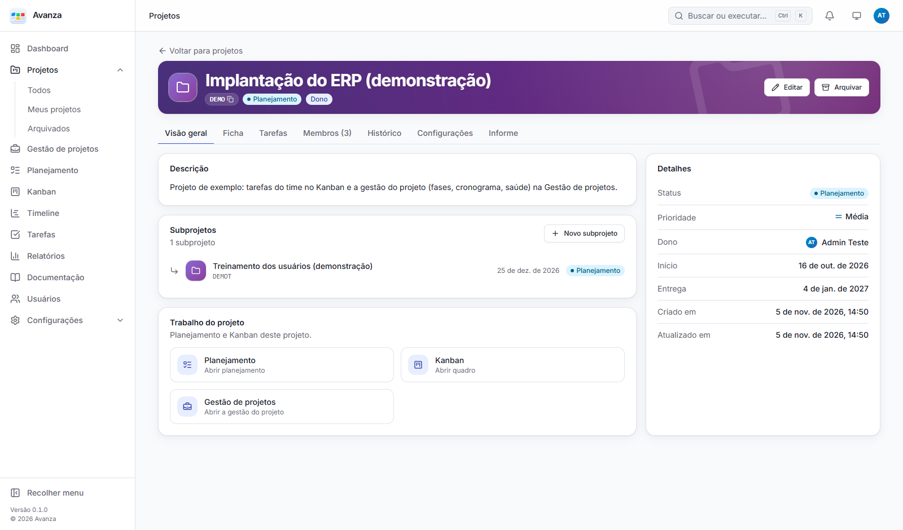
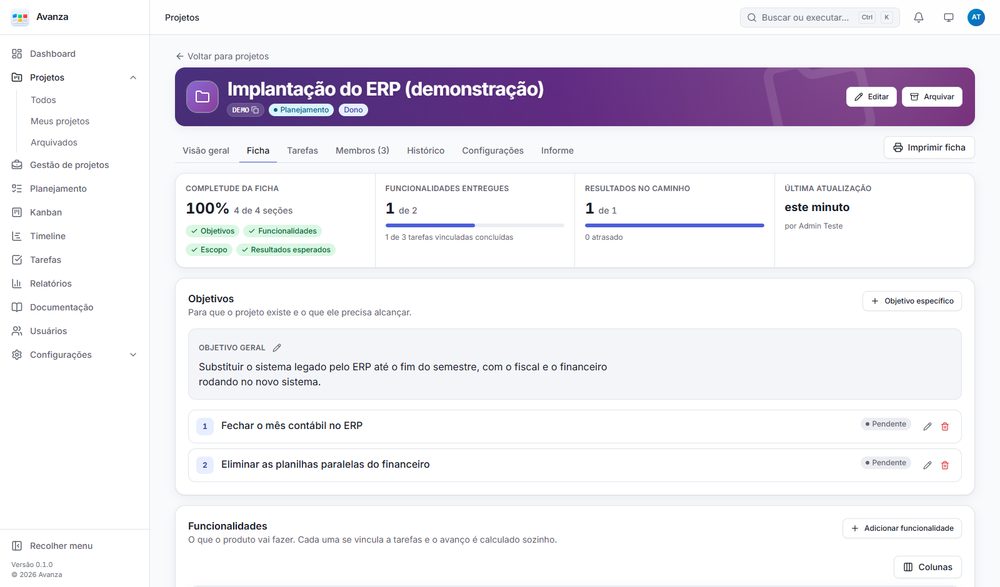
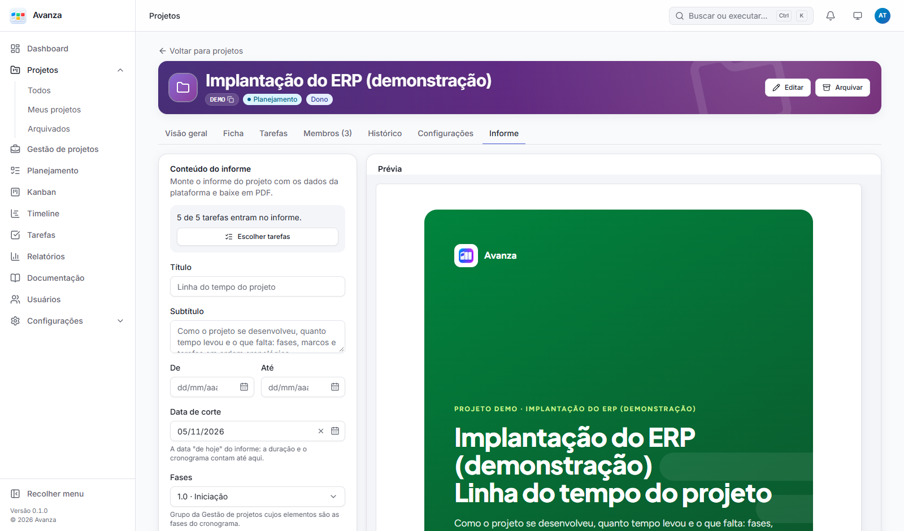
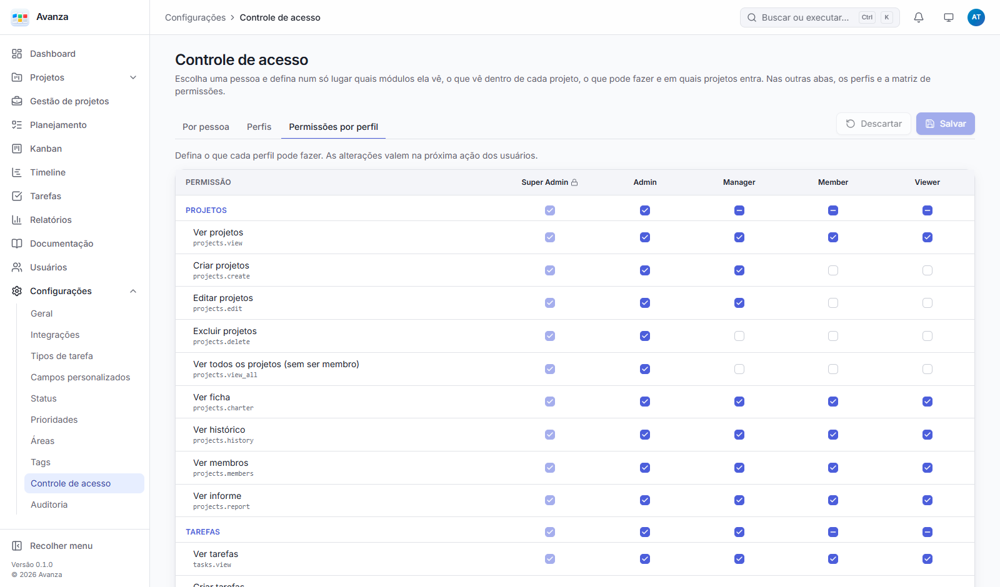
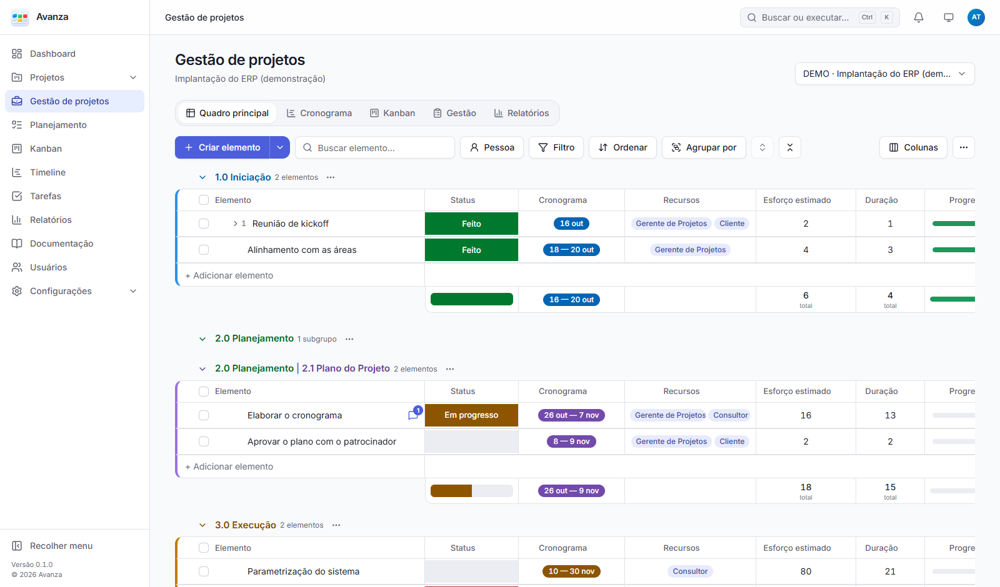
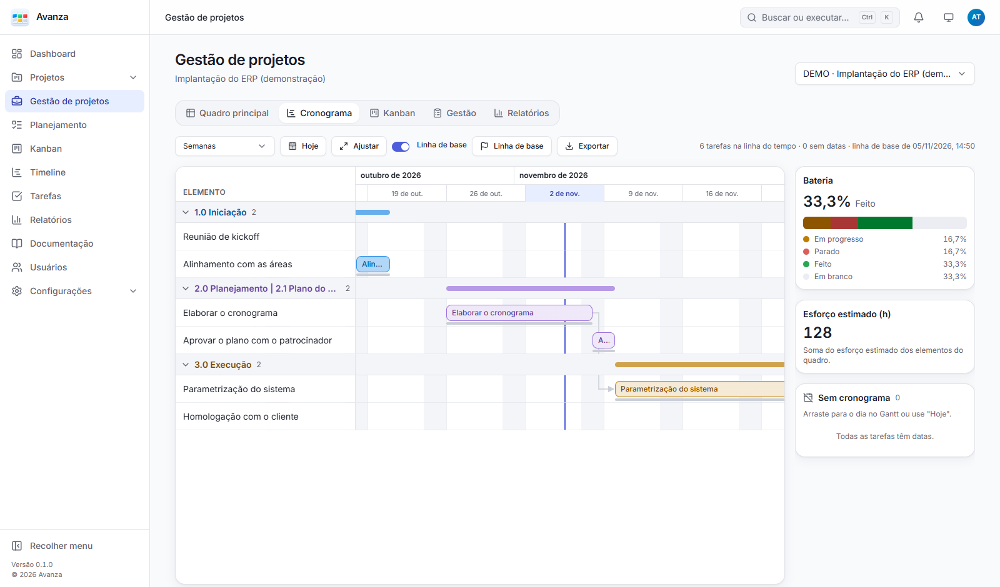
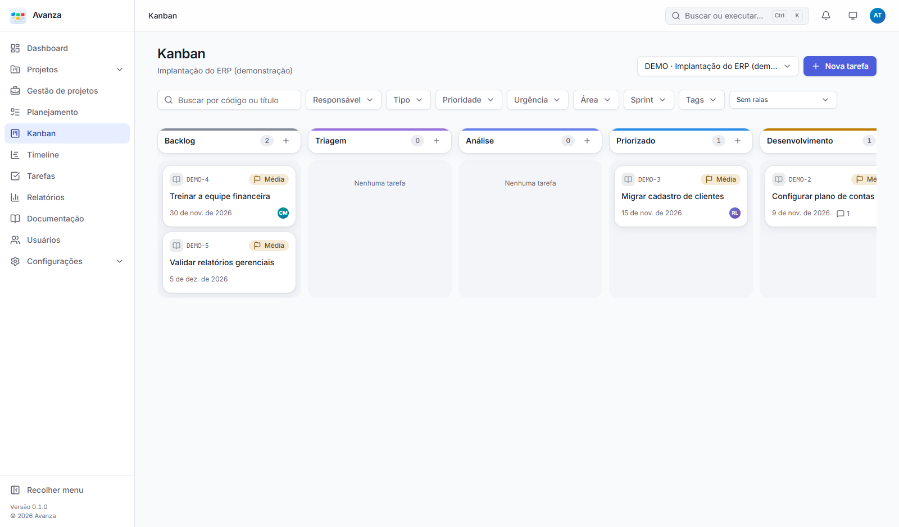

<h1 align="center">Avanza</h1>

<p align="center"><strong>Plataforma de gestão de projetos da Somax Agro.</strong><br />Projetos, tarefas, Kanban, gestão no estilo Monday e documentação num só lugar.</p>

O Avanza é a instalação da Somax do [BLYD Sync](#origem-e-licença). Os pacotes, as variáveis de ambiente e os identificadores técnicos continuam com o nome `kamban`. O nome e o logo que aparecem na tela são configurados em **Configurações → Geral**.

[English](README.en.md) · [Changelog](CHANGELOG.md) · [Implantação](docs/deployment.md) · [Regras de negócio](docs/regras-de-negocio.md)



## Dois modelos de trabalho, lado a lado

| | **Tarefas** (o time) | **Gestão de projetos** (quem coordena) |
|---|---|---|
| Para quê | Executar: o que fazer, quem faz, em que status está | Planejar e acompanhar: fases, entregas, prazos, riscos |
| Onde fica | Aba **Tarefas** do projeto e menus **Tarefas**, **Kanban**, **Planejamento** e **Timeline** | Menu **Gestão de projetos** |
| Unidade | Tarefa com tipo, campos personalizados e fluxo de status | Elemento (e subelementos) dentro de grupos numerados (1.0, 2.1…) |
| Regras | Transições permitidas, campos obrigatórios por status, limite WIP | Etiquetas livres de status e recurso por projeto, dependências com regra configurável |

Os dois ficam no mesmo **projeto** (mesmos membros e permissões), mas não se misturam: mover uma tarefa não mexe no cronograma da gestão, e vice-versa.

## O que tem

**O projeto**
- Abas **Resumo, Ficha, Tarefas, Membros, Histórico, Configurações e Informe**, mostradas conforme o perfil de cada pessoa.
- **Projeto pai e subprojetos** (um só nível): o campo "Projeto pai" no formulário liga o projeto a um programa maior, e o pai mostra o card **Subprojetos**. Para desvincular, escolha "Nenhum (projeto principal)".
- **Ficha:** objetivo geral, objetivos, funcionalidades ligadas às tarefas (o avanço é calculado sozinho), escopo (inclui / não inclui) e resultados com meta e medições. Pode ser impressa em A4.
- **Informe** em PDF com capa, indicadores, cronograma, avanço por fase, linha do tempo e próximos passos. Na aba Tarefas se escolhe o que entra.
- **Histórico** como linha do tempo do diário, dos marcos e das tarefas, com a auditoria logo abaixo.
- **Área responsável** e **urgência** (🔴 🟡 🟢) em projetos, tarefas e Kanban, com coluna, filtro e troca com um clique.

**Tarefas e fluxo**
- Tipos de tarefa com formulário próprio e **17 tipos de campo** personalizado.
- Fluxo de status configurável, **transições permitidas**, **campos obrigatórios por status** e **limite WIP** por coluna.
- Kanban com arrastar e raias; Planejamento com **sprints** e backlog; Timeline com marcos.
- Comentários com **@menções** e imagens coladas, anexos, checklist, tags, relacionamentos, subtarefas e notificações.

**Gestão de projetos**
- Quadro com grupos numerados, elementos e subelementos, edição na célula, seleção em massa, filtros e importação de CSV.
- **Colunas personalizadas**, painel do elemento com atualizações e histórico.
- Visões **Cronograma** (Gantt com dependências e **linha de base**), **Kanban**, **Gestão** (diário de bordo e problemas) e **Relatórios** com a **saúde do projeto**.

**Documentação**
- Espaços e páginas com editor rico, versões com restauração, árvore de páginas e busca.

**Acesso e segurança**
- **Controle de acesso** numa só tela, com as abas **Por pessoa**, **Perfis** e **Permissões por perfil**. Para cada perfil se escolhe também **o que ele vê dentro de cada projeto** (Ficha, Tarefas, Kanban, Gestão de projetos, Histórico, Membros e Informe).
- Papéis por projeto: gestor, membro, leitor e **Responsável TI**. O Responsável TI vê só o resumo do projeto ("O que precisamos da TI") e as tarefas atribuídas a ele ou marcadas com o botão **Visível para TI** 💻 na aba Tarefas. Se o perfil dele tiver Ficha, também vê a ficha, só para leitura.
- Auditoria de toda mudança relevante, sessão segura (cookie HttpOnly, CSRF, CSP) e bloqueio de login.

**Integrações**
- **API REST** documentada (`/api/v1`, OpenAPI em `/api/v1/openapi.json`) com **tokens de API** pessoais.
- **E-mail** ("Esqueci minha senha", convites e notificações), **webhooks** assinados e **tempo real** (as telas se atualizam sozinhas).
- Em português, espanhol e inglês; tema claro e escuro; celular e desktop.

<table>
  <tr>
    <td></td>
    <td></td>
  </tr>
  <tr>
    <td></td>
    <td></td>
  </tr>
  <tr>
    <td></td>
    <td></td>
  </tr>
</table>

## Instalação

**Com Docker** (não precisa de Node no servidor):

```bash
cp .env.docker.example .env      # defina KAMBAN_ADMIN_EMAIL e KAMBAN_ADMIN_PASSWORD
docker compose up -d
```

Abra http://localhost:8090 e entre com o e-mail e a senha do `.env`. Os dados ficam no volume `kamban_data`.

**Sem Docker:** você precisa de Node.js 22 ou mais novo.

```bash
cd backend && npm ci && npm run setup && cd ..   # dependências + binário do PocketBase 0.40.4
cd web && npm ci && cd ..
cp backend/.env.example backend/.env             # defina KAMBAN_ADMIN_EMAIL / KAMBAN_ADMIN_PASSWORD
npm --prefix backend run create-admin            # cria o super administrador
npm run build                                    # compila o web em backend/pb_public
```

Depois suba o PocketBase com os parâmetros de produção de [docs/deployment.md](docs/deployment.md#produção): `--hooksPool=60`, HTTPS na frente e a pasta de dados.

Por último, em **Configurações → Geral**, defina o nome "Avanza", o logo e o ícone.

## Atualizar para uma versão nova

1. Leia o [CHANGELOG](CHANGELOG.md).
2. **Faça backup:** pelo painel `/_/` → Settings → Backups, ou parando o serviço e copiando a pasta `pb_data` inteira.
3. Docker: `git pull && docker compose up -d --build`. Sem Docker: `git pull`, `npm ci` em `backend/` e `web/`, `npm run build` e reinicie o serviço.
4. **As migrations rodam sozinhas ao subir.** Confira os logs e o `GET /api/v1/health` (200).

> ⚠️ O servidor avanza.local tem funções que ainda não estão neste repositório (Arquivos, Homologação). Ao atualizar, integre o código novo **sem sobrescrever** essas funções.

**Depois da versão com Responsável TI e projeto pai** (migrations `1790000036` a `1790000039`):
- Os perfis que já viam projetos continuam vendo todas as seções.
- Para restringir um perfil: **Controle de acesso → Perfis**.
- Para dar o papel **Responsável TI** a alguém: **Membros** do projeto.
- Para mostrar uma tarefa à TI: botão 💻 na aba **Tarefas**.

## Desenvolvimento

```bash
cd backend && npm install && npm run setup && cd ..
cd web && npm install && cd ..
cp backend/.env.example backend/.env
npm --prefix backend run create-admin
npm run dev                                      # API :8090 + web :5173
```

| Comando (raiz) | O que faz |
|---|---|
| `npm run dev` | API e web juntos, com recarga do web |
| `npm run check` | lint, tipos e todos os testes (unitários, componentes e API num PocketBase isolado) |
| `npm run e2e` | build + testes de ponta a ponta no navegador (Edge ou Chrome) |
| `npm run build` | build do web em `backend/pb_public` (servido pelo PocketBase) |
| `npm run demo` | projeto **DEMO** de exemplo no servidor do `backend/.env` (com ficha e subprojeto) |
| `npm run screenshots` | regera as imagens deste README a partir do projeto DEMO |

**Stack:** React 19 + TypeScript + Vite, TanStack Query/Table, Radix UI, Tailwind 4 e i18next no web. No backend, [PocketBase](https://pocketbase.io) 0.40 (Go + SQLite) com hooks em JavaScript, organizados em Clean Architecture. Detalhes em [docs/architecture.md](docs/architecture.md).

## Documentação

| | |
|---|---|
| [Regras de negócio](docs/regras-de-negocio.md) | status, transições, Kanban, ficha, informe, áreas, projeto pai, Responsável TI e controle de acesso |
| [Arquitetura](docs/architecture.md) | camadas, dependências e fluxo de requisição |
| [API](docs/api.md) | convenções, erros e endpoints |
| [Banco de dados](docs/database.md) | collections, índices e auditoria |
| [Segurança](docs/security.md) e [Permissões](docs/permissions.md) | sessão, RBAC, catálogo de permissões |
| [Implantação](docs/deployment.md) | Docker, produção, backup e atualização |
| [Testes](docs/testing.md) · [Design System](docs/design-system.md) · [Decisões](docs/decisions.md) | |

## Origem e licença

O Avanza é baseado no BLYD Sync, open source sob a [Apache License 2.0](LICENSE). Mantenha os avisos de licença e o [NOTICE](NOTICE). Vulnerabilidades: siga a [política de segurança](SECURITY.md).
